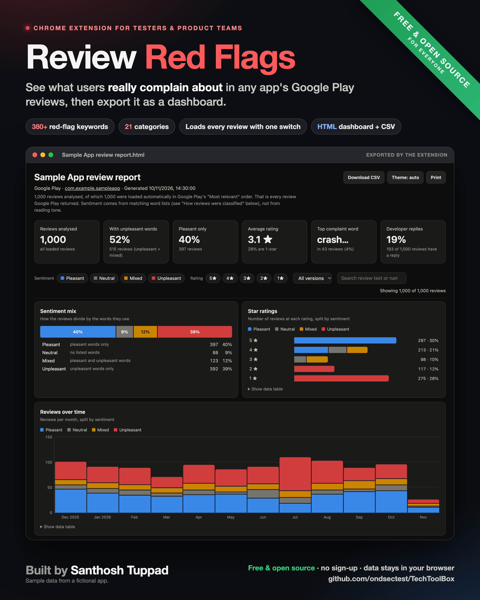

# Review Red Flags

A free, open-source Chrome extension that shows what users really complain about in any app's Google Play reviews. Useful for testers, product teams, developers, and anyone checking an app before they trust it.

## What it does

- **Flags unpleasant reviews and red flags** on any app's Play Store page, and highlights the words.
- **380+ generic keywords in 21 categories:** crashes, bugs, performance, updates, login and verification, profile and settings, payments, orders, notifications, ads, usability, privacy, customer support and more.
- **Editable word lists** for unpleasant and pleasant words, so you can tune it to your own app.
- **Loads every review with one switch**, even while you work in another tab.
- **Stops after a set number of reviews** (1,000 by default), or loads them all.
- **Waits between requests** (500 ms by default) to stay gentle on Google's servers.
- **Exports an HTML dashboard:** sentiment mix, star ratings, reviews over time, top words, problems by app version, most helpful complaints, and a CSV download.

## Install (about one minute)

1. Download [`Google_App_Reviews_Red_Flag_Extractor.zip`](Google_App_Reviews_Red_Flag_Extractor.zip) (open it, then click **Download raw file**).
2. Unzip it. You get a folder called `extension`.
3. In Chrome, go to `chrome://extensions` and turn on **Developer mode** (top right).
4. Click **Load unpacked** and choose the `extension` folder.
5. Open any app on [play.google.com](https://play.google.com/store/apps) and click the extension's icon.

The same files are also in [`Google_App_Reviews_Red_Flag_Extractor/`](Google_App_Reviews_Red_Flag_Extractor/) if you'd rather read the code first.

## Privacy

No sign-up, no tracking, no servers of its own. The extension only talks to Google Play to read the reviews you're looking at. Reports are saved where you choose on your own computer.

## Credits

Built by [Santhosh Tuppad](https://www.linkedin.com/in/santhosh-tuppad-338b7412/). Free and open source for everyone under the [MIT License](../LICENSE).
